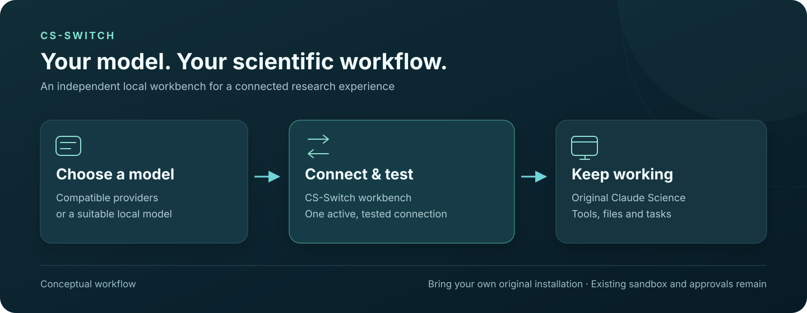

# CS-Switch

**Choose a model. Keep your scientific workflow.**

[](LICENSE)
[](#get-started)

CS-Switch (Claude science-Switch) is an independent local compatibility workbench for using third-party LLMs inside Claude Science. Connect a model, test the connection, then continue working in the original scientific application with its tools, files and task interface.

在本地工作台选择第三方模型，继续使用 Claude Science 的科学工具、文件与任务界面。工作台支持中文 / English，语言选择会保留。

[中文快速使用](#中文快速使用) · [Use cases](#what-you-can-do) · [Get started](#get-started) · [Capabilities & limits](docs/task-capabilities.md) · [Verification](docs/verification.md)



*Conceptual product workflow, not an application screenshot or scientific result.*

> **Independent compatibility software.** This is not an official Anthropic product. You supply your own original Claude Science / Operon executable. Its binaries, assets, trademarks, licenses and services remain separate and are not distributed here.

## 中文快速使用

1. **连接原版程序**：自动查找本机安装，或填写原版可执行文件路径。原版程序保留，工作台使用独立受管理副本；导入已有数据前需退出原版
2. **连接并测试模型**：选择模型、填写密钥并点击“连接并测试”。只有收到真实回复后才保存切换；失败时保留之前的连接
3. **继续科学任务**：点击“打开 Claude Science”或“启动并打开”，从新任务开始。第三方模型负责推理，原版程序执行科学工具并保留其沙箱与审批流程

当前支持 **Linux x64 / Windows 下 Ubuntu WSL**。原生 Windows / macOS 可执行文件仍需平台适配。当前产品版本见 [package.json](package.json)，它与 Claude Science 的版本相互独立。

## What you can do

- **Bring a compatible model into an existing workflow.** Connect OpenAI Chat Completions or Anthropic Messages-compatible providers, including a suitable local model
- **Keep scientific tools close to the task.** Work through the original Python, R, MCP, skills, files, artifacts and agent execution paths, with the original sandbox and approvals
- **Use documents and web evidence where supported.** The bridge handles supported text/PDF input, public search/page reading, structured JSON and mixed web/client-tool continuation. Exact behavior and limits are in the [capability matrix](docs/task-capabilities.md)
- **Manage the application from one local entry.** Discover an installation, connect and test a model, start or stop the managed application, and open the original frontend
- **Recover from a rejected update.** Candidates are validated before activation; idle-only updates retain the previous runtime and its matching data snapshot for rollback

## Designed for careful switching

A failed connection test leaves the working connection in place. Switching does not change the model in the middle of a running task. API keys are encrypted locally and are never returned to the browser; changing the API address requires entering the key again.

Stopping the managed application leaves the workbench available and preserves data. Stop requests are rejected while a task is active. Rollback returns to the prior runtime and its prior data snapshot; newer work stays in its newer generation and does not appear in the older snapshot.

CS-Switch checks compatibility through the actual application structure and runtime behavior. The [verification record](docs/verification.md) documents Claude Science **0.1.47, 0.1.60 and 0.1.62**, with specific provider/tool acceptance runs. These observations do not establish compatibility with every future version, model or scientific task.

## Get started

You need Linux x64 or Ubuntu under WSL, **Node.js ≥22.19**, npm, Bun, bubblewrap, socat, and the prerequisites for your own original Claude Science installation. Use a tool-calling model with enough context; visual tools also need image support. Provider charges and separate service accounts may apply.

```bash
git clone https://github.com/Victor-Xu-1/CS-Switch.git
cd CS-Switch
npm ci
node src/cli.mjs init
node src/cli.mjs serve
```

Open **http://127.0.0.1:8000/_bridge/** to attach your installation and connect a model. The original application opens at **http://127.0.0.1:8000/**. Close the original application first if it occupies port 8000 or you want to import its data.

For a persistent systemd user service, use `node scripts/install-service.mjs` instead of the foreground `serve` command. It refuses to overwrite an existing unit. Keep credentials and runtime data outside the source checkout.

[Full installation and connection guide](docs/getting-started.md) · [Updates, rollback and recovery](docs/operations.md)

## Know the boundaries

A successful connection is the first check. Tool execution and scientific validity require their own evidence. The interface distinguishes configured, connection-tested, tool-tested and scientifically validated states.

- A model must support the task's tools, context and modalities; some hosted tools and provider-specific features need additional adapters
- Text extraction from PDFs is not OCR or visual interpretation. Public search/page access depends on the source website; authenticated browsing and JavaScript browser automation are not reproduced
- External services still need their own authorized accounts or keys. The original application's displayed prices are not authoritative third-party billing
- Unsupported upstream changes retain the current version. There is no promise that future signing keys, binary layouts, identity flows or protocols will work without adaptation

[Exact capability boundaries](docs/task-capabilities.md) · [Observed verification](docs/verification.md)

## License

CS-Switch's first-party source is [MIT-licensed](LICENSE). Dependencies keep their licenses. Claude Science / Operon and external services are not relicensed or included; see [third-party notices](docs/third-party-notices.md).

The repository is public source; this release does not publish an npm package.
